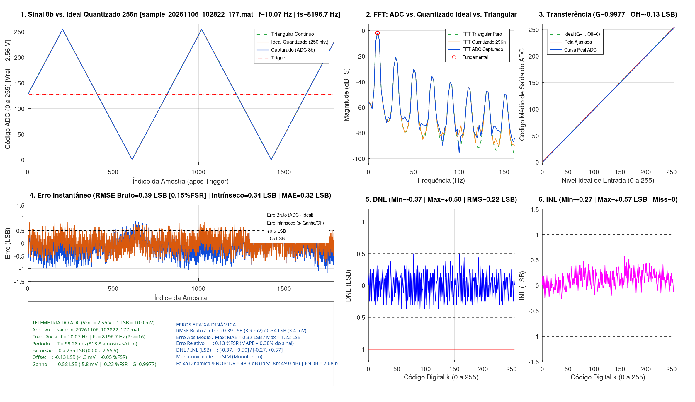
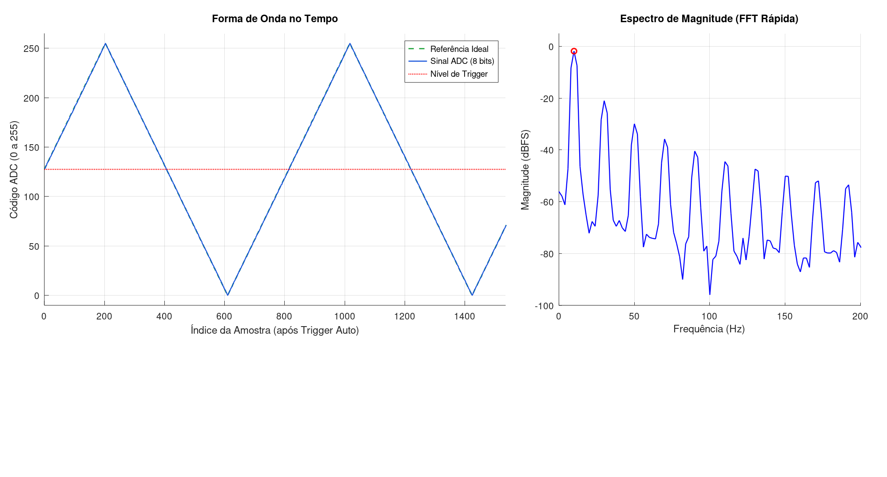
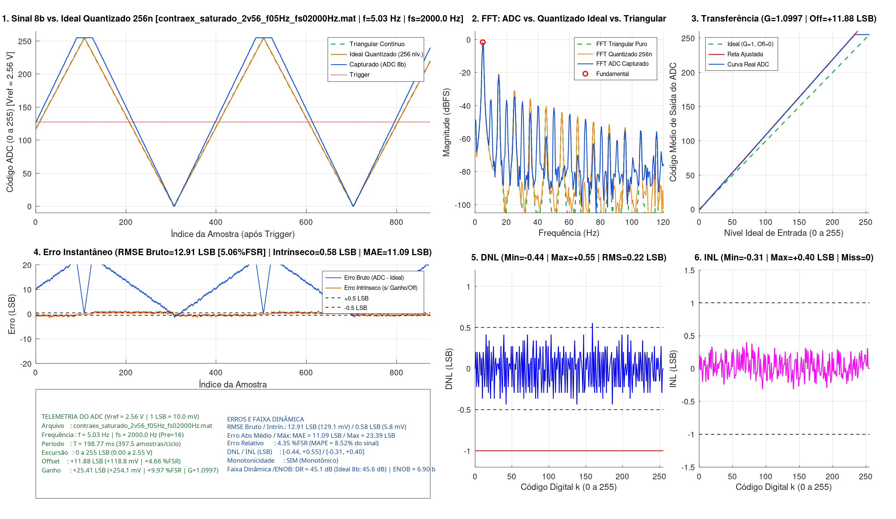

# Caracterização do ADC SAR do ATmega2560

**TEC513 · Processamento Digital de Sinais · UEFS · Problema 02**

Implementação em nível de registradores, aquisição determinística e análise estática/dinâmica do conversor analógico-digital (ADC) de **8 bits** do **ATmega2560 (Arduino Mega 2560)** em conjunto com o **GNU Octave**.

> **Documento principal do projeto:** A fundamentação completa, metodologia, diagramas e discussão detalhada dos resultados encontram-se na apresentação finalizada em [**`docs/presentation/main.pdf`**](docs/presentation/main.pdf) (código-fonte em [`docs/presentation/main.tex`](docs/presentation/main.tex)). Este `README` reúne apenas um resumo enxuto da teoria, das decisões de arquitetura e de exemplos visuais.

---

## 1. Visão Geral e Arquitetura (*Store-and-Forward*)

```text
Gerador de funções → ADC SAR (ATmega2560) → Buffer em SRAM (4.096 amostras)
                                                  ↓
                                    UART0 / USB (envio em lote)
                                                  ↓
                                  GNU Octave → análise e gráficos
```

Para evitar que o tráfego serial interfira na temporização das conversões ou limite a taxa de amostragem, o sistema opera em modo **Store-and-Forward**:

1. **Configuração (5 bytes via UART):** O Octave envia `[prescaler (1B), fs (2B), N (2B)]`. O firmware valida o orçamento de ciclos (`Capture_Validate`) e, se o prescaler mudou, descarta 16 leituras (`DISCARDED_READS = 16U`) para estabilizar o circuito analógico e absorver os 25 ciclos da primeira conversão SAR.
2. **Amostragem Determinística em RAM:** O `Timer1` em modo **CTC** (`prescaler = 8`, resolução de $0{,}5\text{ }\mu\text{s}$) dispara `ISR(TIMER1_COMPA_vect)` na frequência $f_s$. A cada interrupção, o ADC converte o canal `A0`, armazena os 8 bits mais significativos (`ADCH`, com `ADLAR = 1`) em `sampling_buffer` (até $6.144\text{ bytes}$ dos $8\text{ KiB}$ de SRAM) e verifica *overrun* pela flag de hardware `OCF1A` (`TIFR1`). Durante a captura, a UART permanece silenciosa.
3. **Envio em Lote:** Ao completar $N = 4.096\text{ amostras}$, o `Timer1` é desligado e o Arduino transmite `STATUS_OK (0x00)` seguido dos $4.096\text{ bytes}$ via UART0.

### Decisões de Firmware (`firmware/adc_uart/adc_uart.ino`)

- **Eliminação de *Jitter* (`TIMSK0 = 0`):** Desativa a interrupção de *overflow* do `Timer0` do Arduino (`millis()`), que bloquearia interrupções por $\sim 6\text{ }\mu\text{s}$ a cada $1{,}024\text{ ms}$ e causaria atraso periódico no disparo do ADC ou *overrun* em frequências altas.
- **Isolamento Analógico (`DIDR0` / `DIDR2`):** Desliga o buffer digital *Schmitt-Trigger* do pino analógico, evitando corrente de comutação quando a rampa cruza $V_{CC}/2$.
- **Barreiras de Memória (`asm volatile("" ::: "memory")`):** Impedem que o compilador `avr-gcc` reordene o acesso às variáveis de controle e ao `sampling_buffer` em torno do início e do fim da captura por interrupção.
- **UART0 a `115200 baud` com `U2X0 = 1` (quadro `8N1`):** Em $16\text{ MHz}$, o divisor normal (`U2X0 = 0`) produz erro de baud rate de $-3{,}55\%$ (acima do limite tolerável). No modo de velocidade dupla (`U2X0 = 1`, `UBRR0 = 16`), a taxa efetiva é de $117.647\text{ bps}$ ($11.764{,}7\text{ B/s}$, erro de $+2{,}12\%$), transmitindo o bloco de $4.097\text{ bytes}$ em $\approx 348\text{ ms}$.

---

## 2. Resumo da Fundamentação Teórica e Limites Operacionais

### 2.1. Resolução de 8 Bits e Conversão SAR

- **Critério de Erro de Quantização ($\le 0{,}39\%\text{ FSR}$):** Para $n = 8\text{ bits}$ ($2^8 = 256\text{ níveis}$), o passo de quantização é $\Delta = V_{\text{ref}} / 256 = 0{,}390625\%\text{ FSR} \approx 0{,}39\%\text{ FSR}$ (com erro centrado limitado a $\pm \Delta/2 = \pm 0{,}1953\%\text{ FSR}$ e erro RMS teórico de quantização uniforme $\sigma_q = 1/\sqrt{12} \approx 0{,}2887\text{ LSB}$).
- **Troca de 10 para 8 bits (`ADLAR = 1`):** Operar em 8 bits reduz em $4\times$ a sensibilidade a DNL/INL em LSB, reduz pela metade o uso de RAM/UART (`1 byte/amostra`) e permite elevar o clock do ADC SAR de $200\text{ kHz}$ para **$1\text{ MHz}$ (`prescaler = 16`)**, diminuindo o tempo de conversão normal (13 ciclos de clock do ADC) para **$T_{\text{conv}} = 13{,}0\text{ }\mu\text{s}$**.

### 2.2. Limites Teóricos vs. Práticos ($f_s$ e $f_{\text{sinal}}$)

| Parâmetro | Limite Teórico Puro (Hardware ADC) | Limite Prático Determinístico (Firmware) | Justificativa |
| :--- | :--- | :--- | :--- |
| **Tempo mínimo por amostra ($T_{s,\min}$)** | $13{,}0\text{ }\mu\text{s}$ ($13\text{ ciclos ADC}$) | **$30{,}5\text{ }\mu\text{s}$** ($61\text{ ticks}$ do Timer1) | $14\text{ ciclos ADC}$ ($224\text{ ciclos CPU}$) de sincronismo + $256\text{ ciclos CPU}$ de orçamento da ISR $= 480\text{ ciclos}$ ($30{,}0\text{ }\mu\text{s}$). |
| **Taxa de amostragem máxima ($f_{s,\max}$)** | $76.923{,}08\text{ Hz}$ ($1\text{ MHz} / 13$) | **$32.786{,}89\text{ Hz}$** ($16\text{ MHz} / (8 \times 61)$) | Evita *overrun* da ISR e dispensa o modo *Free Running* (que injetaria ruído digital durante o *Sample & Hold*). |
| **Frequência máxima da triangular ($f_{\max}$)** | $150{,}24\text{ Hz}$ ($f_{s,\max} / 512$) | **$64{,}04\text{ Hz}$** ($32.786{,}89 / 512$) | Garante $N_p = f_s / f \ge 512\text{ amostras/ciclo}$ ($256$ na subida e $256$ na descida). |
| **Frequência mínima da triangular ($f_{\min}$)** | $f_s / 4096$ ($0{,}125\text{ Hz}$ em $f_s = 513\text{ Hz}$) | $f_s / 4096$ ($2{,}00\text{ Hz}$ em $f_s = 8192\text{ Hz}$) | Garante ao menos $1\text{ ciclo}$ completo dentro da janela fixa de $N = 4.096\text{ amostras}$. |

---

## 3. Processamento no Octave e Métricas

O pipeline modular em `tools/octave/` executa o condicionamento do sinal e extrai as métricas estáticas e dinâmicas:

1. **Trigger, Período e Referência Ideal (`src/triggering/`, `src/conditioning/`):** Detecção de cruzamentos de nível médio com histerese de $\pm 8\% V_{pp}$ e interpolação linear sub-amostra, seguida de refinamento Simplex (`fminsearch`) de período $T_p$ e fase $\phi_0$ para gerar a onda triangular contínua $y_{\text{cont}}(n) \in [0, 255]$ e sua versão quantizada ideal.
2. **Ganho, Offset e Erros no Tempo (`computeStaticAndTimeErrors.m`):** Regressão linear por mínimos quadrados ($y_{\text{ADC}} \approx G \cdot y_{\text{ideal}} + b$) na região central livre de saturação ($10 \le y_{\text{ideal}} \le 245$), obtendo Erro de Ganho, Erro de Offset, MAE, RMSE bruto e RMSE residual (após compensação de ganho e offset).
3. **Linearidade por Histograma (`computeHistogramLinearity.m`):** Recorte em número inteiro de períodos para calcular $\text{DNL}(k) = H(k)/\overline{H} - 1$, $\text{INL}(k) = \sum [\text{DNL}(j) - \overline{\text{DNL}}]$, contagem de *missing codes* ($H(k) = 0$) e verificação de monotonicidade.
4. **Espectro em `dBFS` e Faixa Dinâmica (`computeSpectralMetrics.m`):** Uma onda triangular ideal possui harmônicas ímpares ($3f_0, 5f_0, \dots$) com decaimento de $1/k^2$ ($3f_0$ a $-19{,}08\text{ dBc}$). O analisador aplica janela de Hann, calcula a FFT tripla normalizada em $\text{dBFS}$ ($0\text{ dBFS} = 127{,}5\text{ LSB}$) e mascara $\pm 3\text{ bins}$ em torno das harmônicas da triangular para integrar o piso de ruído pela relação de Parseval, estimando a **Faixa Dinâmica ($\text{DR}$)** e o **$\text{ENOB}$**.

---

## 4. Principais Resultados e Exemplos Visuais

Nas 35 capturas preservadas (**13 ensaios principais**, **4 contraexemplos didáticos** e **18 repetições**), a calibração com osciloscópio de bancada indicou uma referência interna efetiva de **$V_{\text{ref,real}} \approx 2{,}31\text{ V}$** (dentro da faixa de $2{,}30\text{ V}$ a $2{,}80\text{ V}$ do datasheet para os $2{,}56\text{ V}$ nominais, correspondendo a $1\text{ LSB}_{\text{real}} \approx 9{,}02\text{ mV}$).

| Métrica (13 ensaios principais, $1\text{ Hz}$ a $60\text{ Hz}$) | Resultado observado |
| :--- | :--- |
| **RMSE residual (após ajuste de ganho/offset)** | **$0{,}34\text{ a }0{,}46\text{ LSB}$** (próximo ao limite teórico de $0{,}29\text{ LSB}$) |
| **Erro de Offset / Erro de Ganho residual** | **$-0{,}38\text{ a }+0{,}05\text{ LSB}$** / **$+2{,}24\text{ a }+4{,}29\text{ LSB}$** ($+0{,}88\%$ a $+1{,}68\%\text{ FSR}$) |
| **Faixa Dinâmica (DR) / ENOB estimado** | **$46{,}4\text{ a }48{,}3\text{ dB}$** / **$7{,}26\text{ a }7{,}70\text{ bits}$** |
| **Códigos ausentes (*Missing Codes*)** | **$0$** em todos os 13 ensaios principais |

### Painel de Análise Completa (Amostra de Exemplo)



### Captura no Osciloscópio Digital (`uart_oscilloscope.m`)



### Contraexemplo: Saturação no Topo por Desvio de $V_{\text{ref}}$ ($2{,}56\text{ V}$ vs. $2{,}31\text{ V}$)



---

## 5. Estrutura do Repositório e Execução

```text
docs/presentation/main.pdf           # Apresentação principal do projeto (documento final)
docs/datasheets/                     # Datasheets e esquemáticos do ATmega2560 / Arduino Mega
firmware/adc_uart/adc_uart.ino       # Firmware AVR (Timer1 CTC + ADC SAR + UART0)
data/oscilloscope/                   # Capturas do osciloscópio de bancada (.BMP)
tools/octave/
├── adc_analyzer.m                   # Orquestrador de análise (GUI interativa e modo batch)
├── uart_oscilloscope.m              # Osciloscópio leve de bancada em tempo real
├── uart_capture.m                   # Driver de aquisição UART
├── src/                             # Módulos matemáticos (triggering, conditioning, spectral, linearity)
├── utils/                           # Utilitários de dashboard, I/O e exportação
├── data/                            # Arquivos .mat coletados (principais, contraexemplos e archive/)
└── outputs/                         # Gráficos exportados (.png) e resumo de métricas (.csv)
```

No **GNU Octave**, a partir da raiz do repositório:

```octave
addpath("tools/octave");

adc_analyzer()                                 % Abrir o painel interativo
adc_analyzer("adc_f05Hz_fs04000Hz_pre16.mat")  % Inspecionar uma captura específica
adc_analyzer("batch")                          % Reprocessar todos os ensaios em lote
uart_oscilloscope                              % Osciloscópio em tempo real (requer placa via USB e pacote instrument-control)
```
